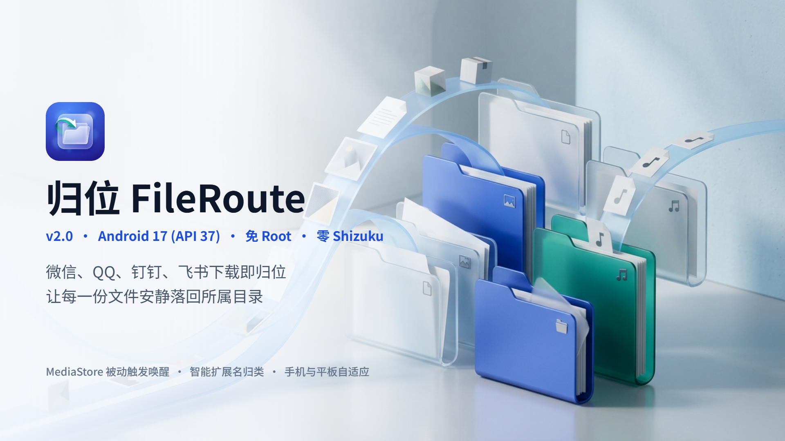

# 归位 FileRoute v3.3 — Android 17（API 37）

程序图标：

免 Root。当前版本 **3.3.0**，签名与 3.2.2 相同，已安装 3.2.2 的手机可以直接覆盖更新。3.2.1 及更早版本因为签名不同，仍需先卸载再安装。

最低安装系统仍是 Android 8.0（API 26）。公共目录监听不需要 Shizuku。

## 版本

| 版本 | 安装包 |
| --- | --- |
| [v3.3.0-android17](https://github.com/legeng49/FileRoute-Android-NoRoot/releases/tag/v3.3.0-android17) | `FileRoute-v3.3.0-android17.apk` |
| [v3.2.2-android17](https://github.com/legeng49/FileRoute-Android-NoRoot/releases/tag/v3.2.2-android17) | `FileRoute-v3.2.2-android17.apk` |
| [v3.2.1-android17](https://github.com/legeng49/FileRoute-Android-NoRoot/releases/tag/v3.2.1-android17) | `FileRoute-v3.2.1-android17.apk` |

已安装 3.2.2 时，打开应用会提示更新到 3.3.0。

## 这一版

1. 用系统目录选择器选归位目录，并统一成 `/storage/emulated/0/...` 路径。
2. 增加过期文件清理。
3. 推送 `v*` 标签后，Actions 自动把 APK 附到对应 Release。

## 安装

打开 [v3.3.0-android17](https://github.com/legeng49/FileRoute-Android-NoRoot/releases/tag/v3.3.0-android17)，下载 `FileRoute-v3.3.0-android17.apk`。
